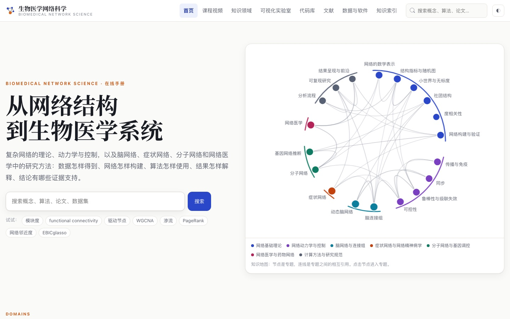

# 生物医学网络科学

**Biomedical Network Science**

一部免费开放的中文在线手册：复杂网络的理论与方法，以及它们在脑科学、精神医学、分子生物学和医学中的应用

### [bionetwork.xizhe.net](https://bionetwork.xizhe.net)

[课程视频](https://bionetwork.xizhe.net/courses.html) · [知识领域](https://bionetwork.xizhe.net/domains.html) · [可视化实验室](https://bionetwork.xizhe.net/lab.html) · [代码库](https://bionetwork.xizhe.net/code.html) · [文献](https://bionetwork.xizhe.net/papers.html) · [数据与软件](https://bionetwork.xizhe.net/resources.html) · [知识索引](https://bionetwork.xizhe.net/glossary.html)

 

 

> 细胞里的蛋白质、大脑里的脑区、患者身上的症状、人群中的疾病，都可以看成一张网。
> 节点是什么？边是什么？整张网有什么结构？结构又怎样决定功能？

本站从网络的数学表示讲起，一直讲到真实生物医学研究中的数据、方法、结果解释和证据判断。

<table>
<tr>
<td align="center"><b>19</b> 知识专题</td>
<td align="center"><b>300+</b> 知识页面</td>
<td align="center"><b>50+</b> 讲解视频</td>
<td align="center"><b>14</b> 交互可视化</td>
<td align="center"><b>200+</b> Python 示例</td>
<td align="center"><b>43</b> 论文精读</td>
<td align="center"><b>55</b> 数据库与软件</td>
</tr>
</table>

## 看什么

<table>
<tr>
<td width="50%" valign="top">

<h3>🎬 课程视频</h3>
按讲次组织的系列讲解：绪论、图论基础、网络模型、社团发现。每集七到十二分钟，配中文字幕和文字稿，可以按自己的节奏观看，下次打开从上次停下的地方继续。
</td>
<td width="50%" valign="top">

<h3>📖 知识专题</h3>
每个专题有一个主页和若干深入的知识页面：定义与公式、推导、生物医学实例、适用范围与常见误用，引用处都给出 DOI。每个专题和每篇精读论文还各有一集动画讲解。
</td>
</tr>
<tr>
<td width="50%" valign="top">

<h3>🧪 可视化实验室</h3>
拖动参数，即时观察网络结构与动力学的变化：邻接矩阵、随机图与巨连通分支、小世界、优先连接、传播与免疫、同步、可控性、脑网络阈值、网络邻近度……
</td>
<td width="50%" valign="top">
<h3>💻 代码库</h3>
两百多个完整、可运行的 Python 示例，附输出图与解读，可在浏览器中直接运行，也可下载为 Notebook。
<h3>📚 文献知识库</h3>
43 篇重要论文的中文精读：研究问题、设计、方法、结论、证据与局限。
<h3>🗂️ 数据与软件</h3>
55 个常用的生物医学网络数据库与分析软件，每个都有中文介绍。
<h3>🔎 知识索引与搜索</h3>
汇集全站的正式定义与公式；搜索支持中文、英文和常见缩写，如 FC、PPI、modularity。
</td>
</tr>
</table>

## 七个知识领域

| | 领域 | 专题 |
|:-:|---|---|
| 🔵 | [**网络基础理论**](https://bionetwork.xizhe.net/d-theory.html) | 复杂系统与网络的数学表示 · 网络结构指标与随机图 · 小世界与无标度网络模型 · 社团结构与社区发现 · 度相关性与网络结构的高阶统计 · 网络构建与统计验证 |
| 🟣 | [**网络动力学与控制**](https://bionetwork.xizhe.net/d-dynamics.html) | 网络上的传播与免疫 · 同步与协同动力学 · 网络鲁棒性、渗流与级联失效 · 网络可控性与稳定性 |
| 🧠 | [**脑网络与连接组**](https://bionetwork.xizhe.net/d-brain.html) | 脑连接组：结构与功能连接 · 动态功能连接与多层脑网络 |
| 🟠 | [**症状网络与网络精神病学**](https://bionetwork.xizhe.net/d-symptom.html) | 症状网络与网络精神病学 |
| 🧬 | [**分子网络与基因调控**](https://bionetwork.xizhe.net/d-molecular.html) | 生物分子网络与拓扑特征 · 基因调控网络推断与共表达分析 |
| 💊 | [**网络医学与药物网络**](https://bionetwork.xizhe.net/d-medicine.html) | 疾病模块、网络邻近度与药物重定位 |
| ⚙️ | [**计算方法与研究规范**](https://bionetwork.xizhe.net/d-methods.html) | 网络分析流程与 NetworkX 实践 · 研究问题、可复现分析与敏感性分析 · 结果呈现与研究前沿 |

对每个生物医学领域，都尽量给出一条完整的知识链：

**数据怎样得到** → **网络怎样构建** → **算法怎样使用** → **结果怎样解释** → **证据是否充分**

## 适合谁

- 学习网络科学的医学、生命科学和心理学专业学生
- 想在自己的研究中使用网络方法的研究生与研究人员
- 希望系统了解“网络视角下的生物医学”的读者

了解基本的线性代数、概率统计和一点 Python 会更顺利，但不是必需的：每个概念都从定义和例子讲起。

## 内容来源

理论内容依据原始论文、经典综述和官方技术文档写成，引用处都给出 DOI。外部资源的版权归原作者，本站只提供链接与介绍。发现错误或有建议，欢迎提交 [Issue](https://github.com/zxzok/bionetwork/issues)。
